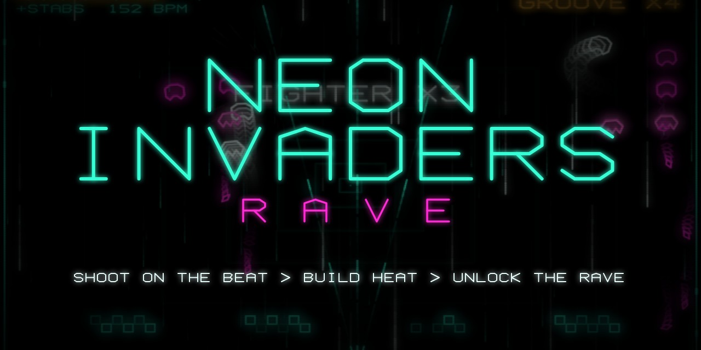
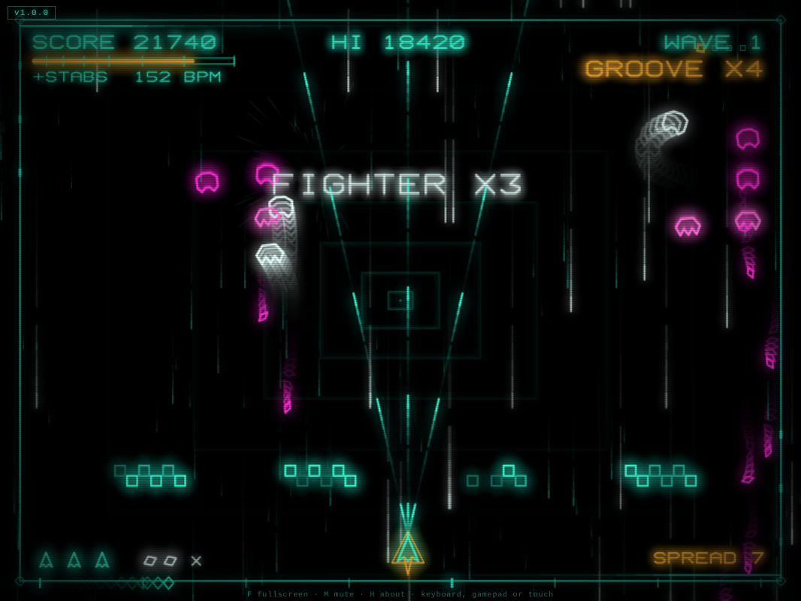
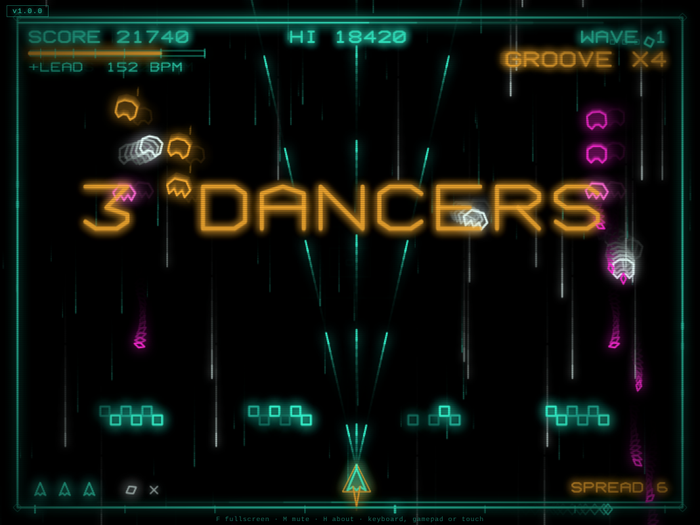
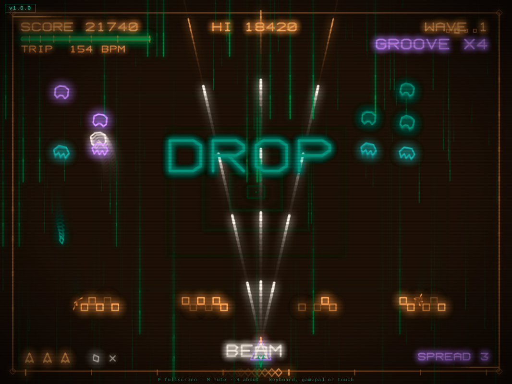

# Neon Invaders Rave

[](https://github.com/kumodot/NeonInvadersRave/tags)
[](LICENSE)
[](#run-it)
[](#tech-notes)

[](https://kumodot.github.io/NeonInvadersRave/)
[](https://github.com/kumodot/NeonInvadersRave/archive/refs/heads/main.zip)
[](https://ko-fi.com/msouza3d)



A Space Invaders and Galaga remix where the soundtrack is the difficulty curve. Kills build heat, heat unlocks layers of a rave techno track that is synthesized live, and every shot you fire snaps to the beat. Vector glow visuals in the spirit of the Vectrex. The whole game, graphics and music included, is one HTML file with no dependencies.

| | | |
|---|---|---|
|  |  |  |
| Fighters dive out of the formation | A rhythm bomb turns invaders into dancers | Full trip layer after the drop |

## Run it

- **Online:** https://kumodot.github.io/NeonInvadersRave/
- **Local:** download the repo and double click `NeonInvadersRave_v1.0.0.html`. No server, no install.
- **Steam Deck:** works in the Desktop Mode browser (stick, D-pad and buttons are mapped). For Game Mode, add the browser as a non-Steam game and open the Pages link. Press *F* or use fullscreen from the browser.
- Sound starts on the first click or key press (browsers block audio before that). The high score is saved in the browser (localStorage), so every player has their own on their own device.

### Controls

| Action | Keyboard | Gamepad | Touch |
|---|---|---|---|
| Move | *Left* / *Right* or *A* / *D* | stick / D-pad | drag |
| Fire | *Space* (tap on the beat, hold to auto fire) | A / RT | tap |
| Rhythm bomb | *X* | B / X / LT | tap the top edge |
| Pause | *P* / *Esc* | Start | |
| Mute | *M* | Back | |
| About | *H* | Y | |
| Fullscreen | *F* | | |

## How it plays

**Heat and music layers**
- Every kill adds heat (*PERFECT* shots add more, the UFO adds a lot). Heat cools down when you stop killing, and dying cuts it in half.
- Layers unlock in order: *KICK*, *+HATS*, *+CLAP*, *+BASS*, *+ACID*, *+LEAD*, *+STABS*, *TRIP*.
- Each layer adds 2 BPM (140 to 154), faster and denser enemy fire, a faster starfield and wilder visuals. At *TRIP* the screen hue drifts and a wireframe tunnel opens behind the field.

**On the beat**
- Shots land on the 8th note grid (16th notes with *RAPID*). A tap within 70 ms of a grid point is *PERFECT*: faster shot, double points, and the *GROOVE* multiplier goes up (max x8). Off beat shots wait for the next grid point and drop the groove.
- At *GROOVE* x6 perfect shots fire a spread. Hold fire for auto shooting on every 8th note, no bonus and no penalty.
- A sweeping marker at the bottom shows the pulse. The frame, side rails, corners, beat counter and the ship exhaust all move with the kick and the hats.

**Break and drop**
- From *+ACID* up, every 8th bar is a *BREAK*: kick out, riser, invaders frozen. The next bar is the *DROP*: enemy bullets vanish, screen quake, and one bar of piercing *BEAM* shots.

**Fighters**
- From *+CLAP* up, invaders peel off the formation with a loop, a sinuous dive to shield height and a climb back to their slot. Worth x3, extra heat, and a better chance to drop a bomb. Touching one costs a life.

**Rhythm bomb**
- Rare drop (more likely from fighters and the UFO). Launches on the next quarter note, rises and bursts. Invaders inside the blast stop shooting and dance for 4 bars (lean, hop, spin and a moonwalk slide on the beat) and are worth x2. A disco cowbell joins the track while anyone is dancing.

**Power ups**
- *SPREAD* (three way shot) and *RAPID* (16th note fire), 10 seconds each.

## Tech notes

- **Audio:** Web Audio API only. Kick, hats, clap, bass, acid line, supersaw lead, stabs, pad and riser are oscillators and filtered noise. The sequencer runs on the audio clock with a lookahead scheduler, so music and shots stay locked to the grid. A sidechain gain gives the pumping feel. Game events (enemy steps, kill sounds, shots) are quantized to the grid.
- **Graphics:** Canvas 2D, line strokes with `shadowBlur` glow, no fills. Phosphor persistence by fading the frame instead of clearing it. A built in 4x6 stroke font. CRT scanlines are a CSS overlay.
- **Input:** keyboard, Gamepad API (Xbox layout, as reported by Steam Input) and pointer events.

## Layout

```
index.html                          Pages entry: reads version.json, redirects to the versioned game
version.json                        current version + entry file
NeonInvadersRave_v1.0.0.html        the game (version in the file name, title bar, title screen and About)
screenshots/                        README images + share banner
docs/                               RELEASE_NOTES_vX.Y.Z.md
README.md  CHANGELOG.md  LICENSE  .gitignore  .gitattributes
```

## License

MIT. See [LICENSE](LICENSE).

Marcelo Souza / Kumodot.art - 2026 // @Msouza3d
